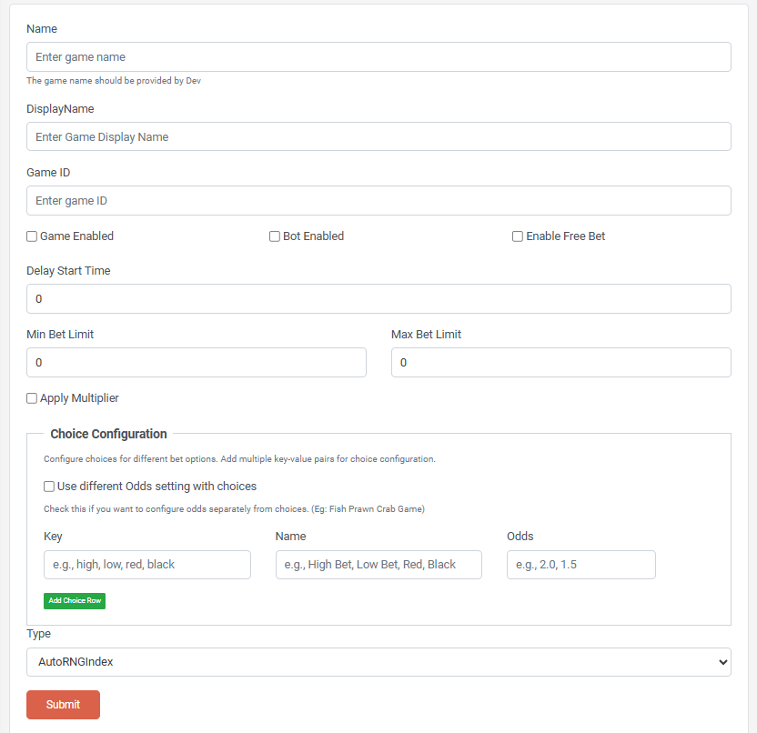

# RNG Round Based Game Setup Guide

## Overview

This guide provides step-by-step instructions for administrators to add new RNG Round Based games to the GamesAdmin system. RNG Round Based games (type: AutoRNGIndex) are custom games that require manual configuration and have unique validation requirements.

## Prerequisites

- Admin access to the GamesAdmin system
- Understanding of game configuration parameters
- Access to the Game Settings management interface

## RNG Round Based Game Characteristics

RNG Round Based games (Game Type: AutoRNGIndex) have the following unique features:

- **Custom Game Names**: Unlike other game types that use predefined names, RNG Round Based games allow custom name input
- **Manual Game ID**: Requires a unique numeric Game ID to be manually specified
- **Choice Configuration**: Supports custom choice options for gameplay
- **Advanced Validation**: System validates both Game ID and Game Name for uniqueness

## Step-by-Step Setup Process

### Step 1: Navigate to Game Creation

1. Log into the GamesAdmin system
2. Navigate to **Game Settings** → **Create New Game**
3. You will see the game creation form

### Step 2: Select Game Type

1. In the **Type** dropdown, select **AutoRNGIndex**
2. The form will automatically adjust to show RNG Round Based game-specific fields:
   - Name field changes to a text input box
   - Game ID field becomes visible and required
   - Choices section appears for configuration



_Figure 1: RNG Round Based game creation form showing all required fields and configuration options_

### Step 3: Configure Basic Game Information

#### Game Name

- **Field**: Name (Text Input)
- **Requirements**:
  - Must be unique across all games
  - **Format**: All lowercase letters, no spaces
  - **Source**: This value should be provided by the developer
  - Used as internal identifier for the game
- **Example**: `"luckywheelpremium"`, `"dragonquestrng"`, `"megajackpot"`

#### Display Name

- **Field**: Display Name
- **Purpose**: User-friendly name shown to players AND used for service URL generation
- **Requirements**:
  - Should be appealing to end users
  - **CRITICAL**: Must match exactly with the Kubernetes service name pattern
  - Used by `NamingConverter.ServiceName()` to generate service URLs
- **Example**: `"Lucky Wheel Premium"` → generates service name `"lucky-wheel-premium"`
- **⚠️ Important**: This field directly impacts service discovery - coordinate with developers

#### Game ID

- **Field**: Game ID (Numeric Input)
- **Requirements**:
  - Must be a positive integer
  - Must be unique across all games in the system
  - Cannot be changed after creation
- **Validation**: System will check for duplicates before saving
- **Example**: `1001`, `2500`, `3750`

### Step 4: Configure Game Settings

#### Enable Settings

- **Game Enabled**: Check to make the game active and available to players
- **Bot Enabled**: Enable/disable bot participation in the game
- **Enable Free Bet**: Allow players to place free bets (if applicable)

#### Timing Configuration

- **Delay Start Time**: Set delay in seconds before game becomes available (default: 0)

#### Betting Limits

- **Min Bet Limit**: Minimum betting amount allowed (default: 0)
- **Max Bet Limit**: Maximum betting amount allowed (default: 0)
- **Apply Multiplier**: Check if betting multipliers should be applied

### Step 5: Configure Choices (RNG Round Based Specific)

RNG Round Based games require at least one choice configuration:

#### Understanding Choices and Odds

RNG Round Based games use a **choice-based system** where players select from predefined options, each with specific payout odds.

#### Choice Configuration Modes

**Standard Mode (Default)**:

- Each choice has its own individual odds setting
- Odds are configured directly in the choice table
- Most common setup for simple games

**Separate Odds Mode**:

- Check **"Use different Odds setting with choices"** for advanced configuration
- Allows global odds settings that override individual choice odds
- Used when game mechanics require complex payout calculations

#### Fish Prawn Crab Game Example

**Fish Prawn Crab** demonstrates when to use separate odds configuration:

- Players bet on 6 symbols (Fish, Prawn, Crab, Coin, Gourd, Rooster)
- Payout varies based on dice results: 1 match = 1:1, 2 matches = 2:1, 3 matches = 3:1
- Standard choice odds can't handle variable payouts, so separate odds mode is used

**Configuration**: Check "Use different Odds setting" and set all choice odds to 1.0 (placeholder values)

#### Choice Configuration Options

**Note**: The choice configuration mode (Standard vs. Separate Odds) should be determined and provided by the developer based on the game's requirements.

1. **Standard Choice Configuration**:

   - Used for games with fixed, individual choice payouts
   - Developer will specify: Leave "Use different Odds setting" unchecked

2. **Separate Odds Configuration**:
   - Used for games with complex, variable payout systems
   - Developer will specify: Check "Use different Odds setting with choices"

#### Choice Parameters Table

- **Key**: Internal identifier for the choice

  - Must be unique within the game
  - Use lowercase, no spaces (e.g., `fish`, `high`, `red`)
  - Used by game logic to identify player selections

- **Name**: User-friendly display name shown to players

  - Can include spaces, capitalization, special characters
  - Should be clear and appealing (e.g., `Fish`, `High Bet`, `Red`)

- **Odds**: Payout multiplier for this choice
  - Standard mode: Actual payout multiplier (e.g., `2.0` = double payout)
  - Separate odds mode: Placeholder value (usually `1.0`)
  - Format: Decimal number (e.g., `1.5`, `2.0`, `3.5`)

#### Adding and Managing Choices

1. **Adding Choices**:

   - Click the **"Add Choice Row"** button to add new options
   - Fill in Key, Name, and Odds for each choice
   - Minimum requirement: At least one choice must be configured

2. **Choice Validation**:
   - Keys must be unique within the game
   - Names should be descriptive and user-friendly
   - Odds must be positive numbers
   - At least one choice is required for game creation

#### Example Choice Configuration

| Key   | Name     | Odds |
| ----- | -------- | ---- |
| high  | High Bet | 2.0  |
| low   | Low Bet  | 1.8  |
| red   | Red      | 2.0  |
| black | Black    | 2.0  |

### Step 6: Validation and Error Handling

The system performs several validations:

#### Automatic Validations

- **Game ID Uniqueness**: Checks if the Game ID already exists
- **Game Name Uniqueness**: Verifies the name isn't already used
- **Required Fields**: Ensures all mandatory fields are completed
- **Choice Configuration**: Validates at least one choice is configured

#### Common Validation Errors

| Error                                    | Cause                    | Solution                                  |
| ---------------------------------------- | ------------------------ | ----------------------------------------- |
| "Game ID [X] already exists"             | Duplicate Game ID        | Choose a different numeric ID             |
| "Game name '[Name]' already exists"      | Duplicate Game Name      | Get a new unique name from developer      |
| "Game ID is required"                    | Empty or invalid Game ID | Enter a positive integer                  |
| "Invalid game name format"               | Incorrect name format    | Use lowercase, no spaces (from developer) |
| "At least one choice must be configured" | No choices added         | Add at least one choice option            |

### Step 7: Review and Submit

1. **Review Configuration**:

   - Verify all fields are correctly filled
   - Check Game ID and Name for uniqueness
   - Confirm betting limits are appropriate
   - Ensure choices are properly configured

2. **Submit Game**:
   - Click the **Submit** button
   - If validation errors occur, fix them and resubmit
   - Upon success, you'll be redirected to the Game Management page

## Developer Considerations

### Service Configuration and Deployment

**Important for Developers**: When deploying RNG Round Based games, follow these configuration conventions based on the production system:

#### GameServiceTemplate Configuration

RNG Round Based games use the `GameServiceTemplate` pattern instead of individual `GameServers` entries:

- **Template Location**: `GameServiceTemplate` property in environment-specific appsettings.json
- **Template Format**: `http://{prefix}-{0}-service-{env}-service:5000`
- **Service Name Generation**: Uses `NamingConverter.ServiceName(displayName, ServiceNameSeparator)`

#### Environment-Specific Templates

**Production (SC1)**:

```json
"GameServiceTemplate": "http://l1-{0}-service-prod-service:5000"
```

**UAT (SC1)**:

```json
"GameServiceTemplate": "http://l1-{0}-service-uat-service:5000"
```

**GN System (UAT)**:

```json
"GameServiceTemplate": "http://gn-{0}-service-uat-service:5000"
```

#### Service Name Convention

The `{0}` placeholder is replaced using `NamingConverter.ServiceName()`:

1. **Input**: Game Display Name (e.g., `"Lucky Wheel Premium"`)
2. **Process**:
   - Replace spaces with `ServiceNameSeparator` (default: `"-"`)
   - Convert to lowercase
3. **Output**: Service name (e.g., `"lucky-wheel-premium"`)

#### Complete Service URL Examples

**Display Name**: `"Lucky Wheel Premium"`  
**Generated Service Name**: `"lucky-wheel-premium"`  
**Final URL**: `http://l1-lucky-wheel-premium-service-prod-service:5000`

#### Kubernetes Service Naming Requirements

- **Service Name**: `{system-prefix}-{game-display-name-with-dashes}-service-{environment}-service`
- **Port**: Standard port `5000`
- **Environment Prefixes**: `l1` (SC1), `gn` (GN), `l2` (VG2)
- **Naming Converter**: Automatically converts display names to service names

#### Developer Service Creation Guide

When creating a new RNG Round Based game service, follow these steps:

**Step 1: Get Display Name from Admin**

- Coordinate with admin team to get the exact **Display Name** that will be entered
- Example: Admin enters `"Lucky Wheel Premium"` as Display Name

**Step 2: Generate Service Name**

- Use `NamingConverter.ServiceName()` logic:
  ```csharp
  var serviceName = displayName.Replace(" ", "-").ToLowerInvariant();
  // "Lucky Wheel Premium" → "lucky-wheel-premium"
  ```

**Step 3: Create Kubernetes Service**

- **Service Name Pattern**: `{system-prefix}-{service-name}-service-{env}-service`
- **Production Example**: `l1-lucky-wheel-premium-service-prod-service`
- **UAT Example**: `l1-lucky-wheel-premium-service-uat-service`
- **Port**: `5000`

**Step 4: Implement API Endpoint**

- Service must respond to: `GET /api/onlineusers`
- Return type: `OnlineUsers` object
- Include Authorization header handling

#### Implementation Notes

- **No Manual GameServers Entry**: RNG Round Based games use the template, not individual entries
- **Display Name Dependency**: Service URL is generated from the Display Name field
- **Environment Consistency**: Each environment has its own template pattern
- **Automatic Resolution**: System automatically resolves service URLs using the template

#### Critical Requirements

1. **Exact Display Name Match**: The Display Name in admin panel MUST exactly match your service naming
2. **Service Name Convention**: Follow `{prefix}-{display-name-with-dashes}-service-{env}-service`
3. **API Endpoint**: Implement `GET /api/onlineusers` endpoint
4. **Port Consistency**: Use port `5000` for all environments
5. **Environment Prefixes**: `l1` (SC1), `gn` (GN), `l2` (VG2)

**⚠️ Warning**: If Display Name doesn't match service name, the system cannot connect to your service!

## Post-Creation Management

### Monitoring

- New games appear in the Game Management interface
- Monitor game status and performance
- Check for any configuration issues

### Modifications

- Most settings can be modified after creation
- **Game ID cannot be changed** once created
- Use the Edit functionality for updates

---

**Note**: This guide is based on the current system implementation. Always verify with the latest system documentation and test in a development environment before creating production games.
