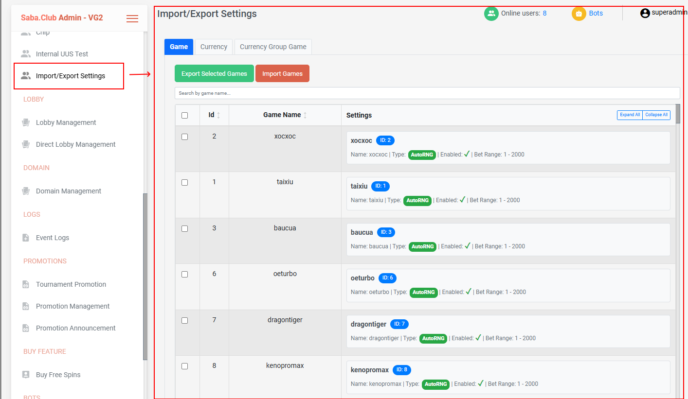
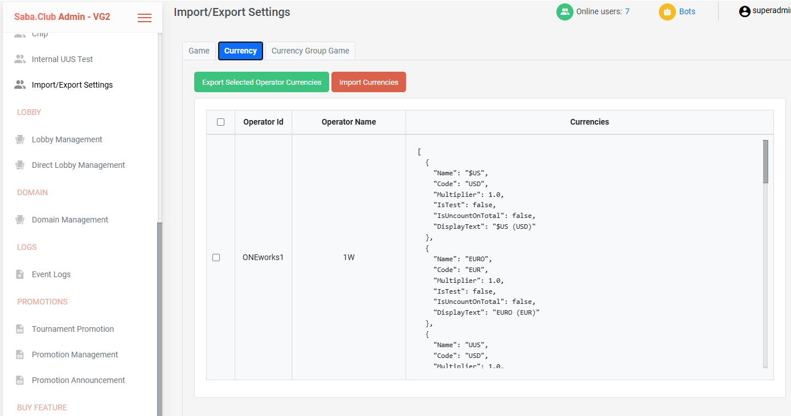
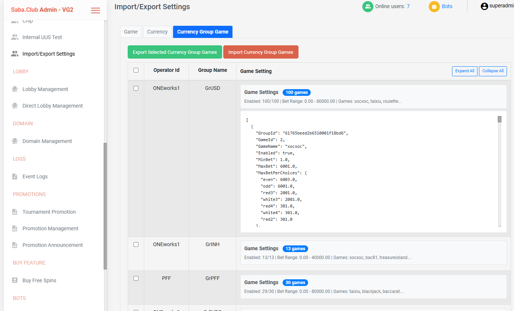

# OperateSettings Import/Export User Guide

## Overview

The OperateSettings feature provides comprehensive import/export functionality for managing three critical aspects of the gaming system. This revolutionary feature allows you to save and restore game settings, currency configurations, and currency group games across different environments, enabling rapid setup and consistent configurations.

## Table of Contents

- [What Are Import/Export Features?](#what-are-importexport-features)
- [Key Benefits](#key-benefits)
- [Getting Started](#getting-started)
- [Three Types of Operations](#three-types-of-operations)
- [How to Use Import/Export](#how-to-use-importexport)
- [File Formats and Naming](#file-formats-and-naming)
- [Best Practices](#best-practices)
- [Common Issues](#common-issues)
- [Troubleshooting](#troubleshooting)

## What Are Import/Export Features?

These features allow you to save your game settings to files and restore them later. This is useful for backing up your work, sharing settings with other administrators, or quickly setting up multiple games with similar configurations.

### Key Benefits

- **Rapid Environment Setup**: Set up new environments in minutes instead of hours
- **Configuration Backup**: Never lose your settings with easy backup/restore
- **Bulk Operations**: Manage multiple games and settings at once
- **Cross-Environment Sync**: Keep all environments consistent
- **Disaster Recovery**: Quick restoration of configurations after issues

## Table of Contents

- [Prerequisites](#prerequisites)
- [Accessing OperateSettings](#accessing-operatesettings)
- [Game Operations](#game-operations)
- [Currency Operations](#currency-operations)
- [Currency Group Game Operations](#currency-group-game-operations)
- [File Formats](#file-formats)
- [Troubleshooting](#troubleshooting)
- [Best Practices](#best-practices)

## Getting Started

### For New Users

#### 1. Accessing the System

- Get your login credentials from your system administrator
- Open your web browser and go to the GamesAdmin website
- Log in using your username and password
- Navigate to **Import/Export Settings** from the main menu (left sidebar)

#### 2. Understanding the Interface

The Import/Export Settings page has three main tabs:

- **Game** - Manage individual game configurations
- **Currency** - Manage currency settings for operators
- **Currency Group Game** - Manage currency group game settings

Each tab loads in its own section when you click on it.

#### 3. Basic Tasks You'll Learn

- **Exporting Settings**: Save game configurations to files for safekeeping
- **Importing Settings**: Load configurations to quickly set up new environments
- **Bulk Operations**: Manage multiple games, currencies, and settings at once
- **Environment Sync**: Keep all environments consistent with the same settings

#### 4. Advanced Features

- **Selective Operations**: Choose specific items to export/import
- **File Validation**: Ensure files are properly formatted before importing
- **Cross-Environment Management**: Sync settings between different environments

### For Current Users

#### New Features You Should Know About

- **Enhanced Import/Export**: Easily backup and restore all settings across environments
- **Rapid Environment Setup**: Set up new environments in minutes instead of hours
- **Bulk Operations**: Manage multiple games and settings at once

#### How to Use New Features

- **Backup Your Settings**: Export all current game configurations before making changes
- **Test New Features**: Try new features in a test environment first
- **Update Your Workflow**: Include new features in your regular tasks

## Prerequisites

- Admin access to the GamesAdmin system
- Understanding of game configuration parameters
- Basic knowledge of JSON file format
- Access to the OperateSettings management interface

## Accessing OperateSettings

1. Log into the GamesAdmin system
2. Navigate to **Import/Export Settings** from the main menu (left sidebar)
3. You will see a tabbed interface with three main sections:
   - **Game** - Individual game management
   - **Currency** - Currency settings management
   - **Currency Group Game** - Currency group game management

Each tab loads its content in a separate section when clicked.

## Game Operations

### Overview

Game Operations allows you to import/export individual game configurations, including game settings, betting limits, odds, and other game-specific parameters.

### Exporting Game Configurations

#### Step 1: Select Games to Export

1. Navigate to the **Game Operations** tab
2. Use the search box to filter games by name if needed
3. Select individual games by checking their checkboxes
4. Use the "Select All" checkbox to select all visible games
5. Click **"Export Selected Game Configs"**

#### Step 2: Download Configuration File

- The system will automatically generate a JSON file
- File naming format: `game-configs-YYYY-MM-DD.json`
- The file contains all selected game configurations



_Figure 1: Game configuration export process showing game selection and download_

#### Export File Structure

```json
[
  {
    "id": "1001",
    "gameId": 1001,
    "name": "luckywheel",
    "odds": {
      "high": 2.0,
      "low": 1.8
    },
    "oddsDisplayNames": {
      "high": "High Bet",
      "low": "Low Bet"
    },
    "choices": [
      {
        "key": "high",
        "name": "High Bet",
        "odds": 2.0
      },
      {
        "key": "low",
        "name": "Low Bet",
        "odds": 1.8
      }
    ],
    "info": {
      "gameId": 1001,
      "displayName": "Lucky Wheel Premium",
      "type": 0,
      "name": "Lucky Wheel",
      "enableFreeBet": true,
      "siteExclusions": null,
      "randomMode": 1,
      "maxWinPerRound": 0,
      "applyMultiplier": false,
      "haveTournament": false,
      "haveVideoStream": false,
      "useMargin": false
    },
    "enableSetting": {
      "enabled": true,
      "disabledMessage": "Game đang được bảo trì, vui lòng quay lại sau 10 phút.",
      "disabledRound": 0,
      "delayStartTime": 0
    },
    "betLimit": {
      "minBet": 1.0,
      "maxBet": 1000.0,
      "maxBetChoices": null
    },
    "botSetting": null,
    "slotsConfig": null,
    "cascadingSlotsConfig": null,
    "slotRNGConfig": null,
    "crashConfig": null,
    "oddsMultipliers": null,
    "tournamentConfig": null,
    "videoStreamConfig": null,
    "margin": null
  }
]
```

### Importing Game Configurations

#### Step 1: Prepare Import File

1. Ensure your JSON file follows the correct structure (see Export File Structure above)
2. Verify all required fields are present
3. Check that Game IDs are unique and valid

#### Step 2: Import Process

1. Click **"Import Game Configs"**
2. Select your JSON file from the file picker
3. The system will validate the file and show a confirmation modal
4. Review the list of games to be imported
5. Select/deselect specific games using checkboxes
6. Click **"Import Selected"** to proceed

#### Step 3: Review Results

- The system will display a detailed import result
- Shows success/failure status for each game
- Lists specific error messages for failed imports

### Game Operations Features

#### Search and Filter

- **Search Box**: Filter games by name in real-time
- **Sortable Columns**: Click column headers to sort by ID or Game Name
- **Select All**: Toggle all visible games at once

#### Game Details View

- **Collapse/Expand**: Click on game summary to view detailed settings
- **Expand All/Collapse All**: Buttons to control all game details visibility
- **Game Information**: Shows game type, enabled status, bet ranges
- **Settings Preview**: Displays formatted JSON of game configuration

## Currency Operations

### Overview

Currency Operations manages operator currency configurations, allowing you to import/export currency settings for different operators.

### Exporting Currency Settings

#### Step 1: Select Operators

1. Navigate to the **Currency Operations** tab
2. Review the list of operators and their currency configurations
3. Select operators by checking their checkboxes
4. Use the "Select All" checkbox to select all operators
5. Click **"Export Selected Operator Currencies"**

#### Step 2: Download Configuration File

- File naming format: `operator-currencies_YYYYMMDD_HHMM.json`
- Contains currency configurations for selected operators



_Figure 2: Currency settings export process showing operator selection and download_

#### Export File Structure

```json
[
  {
    "operator": "OP001",
    "currencies": [
      {
        "Name": "US Dollar",
        "Code": "USD",
        "Multiplier": 1.0,
        "IsTest": false,
        "IsUncountOnTotal": false,
        "DisplayText": "US Dollar (USD)"
      },
      {
        "Name": "Euro",
        "Code": "EUR",
        "Multiplier": 0.85,
        "IsTest": false,
        "IsUncountOnTotal": false,
        "DisplayText": "Euro (EUR)"
      }
    ]
  }
]
```

### Importing Currency Settings

#### Step 1: Prepare Import File

1. Ensure your JSON file follows the correct structure
2. Verify operator IDs exist in the system
3. Check currency codes and rates are valid

#### Step 2: Import Process

1. Click **"Import Currencies"**
2. Select your JSON file
3. The system validates the file structure
4. Import results are displayed in a modal

#### Step 3: Review Results

- Success/failure status for each operator
- Detailed error messages for failed imports
- Summary of imported currency configurations

### Currency Operations Features

#### Operator List

- **Operator ID**: Unique identifier for each operator
- **Operator Name**: Display name of the operator
- **Currencies**: JSON preview of currency configurations
- **Select All**: Toggle all operators at once

## Currency Group Game Operations

### Overview

Currency Group Game Operations manages currency group game settings, allowing you to import/export complex configurations that link currency groups with specific game settings.

### Exporting Currency Group Games

#### Step 1: Select Currency Groups

1. Navigate to the **Currency Group Game Operations** tab
2. Review the list of currency groups and their game settings
3. Select currency groups by checking their checkboxes
4. Click **"Export Selected Currency Group Games"**

#### Step 2: Configure Export

1. A modal will open showing selected currency groups
2. Each group shows its game settings
3. Use **"Select All"** checkboxes to select all games in a group
4. Individual game checkboxes allow granular selection
5. Click **"Export"** to download the configuration



_Figure 3: Currency group game export process showing group selection and game configuration modal_

#### Step 3: Download Configuration File

- File naming format: `currency-group-games-YYYY-MM-DDTHH-MM-SS.json`
- Contains selected currency group game configurations

#### Export File Structure

```json
[
  {
    "operatorId": "OP001",
    "groupName": "Premium Games",
    "gameSettings": [
      {
        "GroupId": "group123",
        "GameId": 1001,
        "GameName": "Lucky Wheel",
        "Enabled": true,
        "MinBet": 1.0,
        "MaxBet": 1000.0,
        "MaxBetPerChoices": null,
        "Chips": null,
        "BetLevels": null,
        "StakeLevels": null,
        "CoinValues": null,
        "DefaultCoinValue": null,
        "DefaultBetLevel": null,
        "Multiplier": 0,
        "MaxWinPerRound": 5000.0,
        "OtherGameIdsInGroup": []
      }
    ]
  }
]
```

### Importing Currency Group Games

#### Step 1: Prepare Import File

1. Ensure your JSON file follows the correct structure
2. Verify operator IDs and group names exist
3. Check game IDs are valid
4. Validate game settings parameters

#### Step 2: Import Process

1. Click **"Import Currency Group Games"**
2. Select your JSON file
3. The system validates the file and shows a review modal
4. You can modify operator IDs and group names if needed
5. Click **"Import"** to proceed

#### Step 3: Review Results

- Success/failure status for each currency group
- Detailed error messages for failed imports
- Summary of imported configurations

### Currency Group Game Operations Features

#### Advanced UI Controls

- **Collapse/Expand**: Click on group summaries to view game details
- **Expand All/Collapse All**: Control visibility of all group details
- **Game Selection**: Granular selection of individual games within groups
- **Search and Filter**: Find specific groups or games

#### Group Information Display

- **Operator ID**: Unique operator identifier
- **Group Name**: Currency group name
- **Game Count**: Number of games in the group
- **Enabled Status**: Count of enabled vs total games
- **Bet Range**: Min/max bet limits across all games
- **Game List**: Preview of game names in the group

## File Formats

### JSON Structure Requirements

All import/export files use JSON format with specific structure requirements:

#### Game Operations Files

```json
[
  {
    "id": "string",
    "gameId": "number",
    "name": "string",
    "odds": "object",
    "oddsDisplayNames": "object",
    "choices": "array",
    "info": {
      "gameId": "number",
      "displayName": "string",
      "type": "number",
      "name": "string",
      "enableFreeBet": "boolean",
      "siteExclusions": "array",
      "randomMode": "number",
      "maxWinPerRound": "number",
      "applyMultiplier": "boolean",
      "haveTournament": "boolean",
      "haveVideoStream": "boolean",
      "useMargin": "boolean"
    },
    "enableSetting": {
      "enabled": "boolean",
      "disabledMessage": "string",
      "disabledRound": "number",
      "delayStartTime": "number"
    },
    "betLimit": {
      "minBet": "number",
      "maxBet": "number",
      "maxBetChoices": "object"
    },
    "botSetting": "object",
    "slotsConfig": "object",
    "cascadingSlotsConfig": "object",
    "slotRNGConfig": "object",
    "crashConfig": "object",
    "oddsMultipliers": "object",
    "tournamentConfig": "object",
    "videoStreamConfig": "object",
    "margin": "array"
  }
]
```

#### Currency Operations Files

```json
[
  {
    "operator": "string",
    "currencies": [
      {
        "Name": "string",
        "Code": "string",
        "Multiplier": "number",
        "IsTest": "boolean",
        "IsUncountOnTotal": "boolean",
        "DisplayText": "string"
      }
    ]
  }
]
```

#### Currency Group Game Operations Files

```json
[
  {
    "operatorId": "string",
    "groupName": "string",
    "gameSettings": [
      {
        "GroupId": "string",
        "GameId": "number",
        "GameName": "string",
        "Enabled": "boolean",
        "MinBet": "number",
        "MaxBet": "number",
        "MaxBetPerChoices": "object",
        "Chips": "array",
        "BetLevels": "array",
        "StakeLevels": "array",
        "CoinValues": "array",
        "DefaultCoinValue": "number",
        "DefaultBetLevel": "number",
        "Multiplier": "number",
        "MaxWinPerRound": "number",
        "OtherGameIdsInGroup": "array"
      }
    ]
  }
]
```

### File Naming Conventions

- **Game Operations**: `game-configs-YYYY-MM-DD.json`
- **Currency Operations**: `operator-currencies_YYYYMMDD_HHMM.json`
- **Currency Group Games**: `currency-group-games-YYYY-MM-DDTHH-MM-SS.json`
